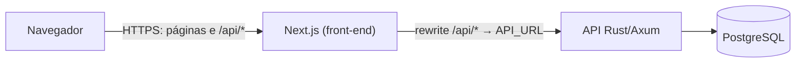

# TabWallet

Aplicação web de controle financeiro pessoal: a própria pessoa registra Receitas, Despesas, Transações fixas e compras no Cartão de crédito, e o sistema calcula o Saldo atual, o Saldo projetado de 12 meses, as Faturas, os Orçamentos e os relatórios. Não há integração bancária. O slogan: "Seu dinheiro, em uma aba."

O projeto é o MVP descrito no [termo de abertura](docs/termo-abertura-tabwallet.md) (Anexo I: casos de uso UC01–UC22, requisitos e arquitetura).

## Onde está cada coisa

| Documento | Para quê |
| --- | --- |
| [`docs/termo-abertura-tabwallet.md`](docs/termo-abertura-tabwallet.md) | Escopo, casos de uso, requisitos não funcionais e arquitetura (seções 2 a 4 do Anexo I) |
| [`GLOSSARY.md`](GLOSSARY.md) | Vocabulário do domínio (Saldo atual, Fatura, Mês de referência...), com o nome usado no código |
| [`docs/adr/`](docs/adr) | Decisões de arquitetura: [0001](docs/adr/0001-shadcn-ui-no-front-end.md) shadcn/ui, [0002](docs/adr/0002-calculo-na-leitura.md) cálculo na leitura, [0003](docs/adr/0003-compras-no-cartao-e-saldo.md) compras no cartão e saldo |
| [`docs/design/`](docs/design/README.md) | Manual de marca e Design System (tokens, componentes) |
| [`docs/nao-funcionais.md`](docs/nao-funcionais.md) | Como cada requisito não funcional foi verificado, com os números medidos |
| [`backend/README.md`](backend/README.md) | API: rotas, regras e como rodar os testes |
| [`frontend/README.md`](frontend/README.md) | Telas, organização e autenticação do front-end |

## Stack

- **Back-end** (`backend/`): Rust, Axum, `sqlx` e PostgreSQL 17. Camadas: handlers HTTP, use cases (`*UseCase`) e repositórios. Dinheiro em centavos inteiros; "hoje" vem de um relógio injetável no fuso America/Sao_Paulo.
- **Front-end** (`frontend/`): Next.js 16 (App Router), React 19, TypeScript, TanStack Query, Recharts e shadcn/ui sobre Tailwind CSS v4 com o tema do Design System.
- **Sessão**: JWT em cookie `httpOnly` (`SameSite=Lax`, `Secure` em produção). O navegador só fala com o Next.js; ele encaminha `/api/*` à API (uma origem só, sem CORS).
- **CI/CD**: GitHub Actions: `.github/workflows/ci.yml` (jobs `backend` e `frontend`) e `.github/workflows/deploy.yml` (deploy em produção depois do CI verde na `main`; veja [Deploy](#deploy)).



## Como rodar localmente

Pré-requisitos: Node.js 22, Docker e, para rodar a API direto, Rust stable (no Windows, as ferramentas de build C++ do Visual Studio).

### Opção 1: Rust instalado

```bash
# 1. Banco e API
cd backend
docker compose up -d            # PostgreSQL em localhost:5432
cp .env.example .env
cargo run                       # aplica as migrations e sobe em 127.0.0.1:8080

# 2. Front-end (outro terminal)
cd frontend
cp .env.example .env.local      # API_URL=http://127.0.0.1:8080
npm ci
npm run dev                     # http://localhost:3000
```

### Opção 2: sem Rust nativo (só Docker), como no Windows sem as ferramentas C++

```bash
backend/scripts/dev-api.sh 8080     # API + PostgreSQL descartável, na porta 8080 (Ctrl-C para parar)
cd frontend && npm ci && npm run dev
```

Os dados do `dev-api.sh` somem quando ele é encerrado. Em desenvolvimento, o link de recuperação de senha aparece no log da API, porque nenhum e-mail é enviado.

## Variáveis de ambiente

### API (`backend/`, veja `backend/.env.example`)

| Variável | Em produção | Descrição |
| --- | --- | --- |
| `DATABASE_URL` | obrigatória | Conexão com o PostgreSQL. |
| `JWT_SECRET` | obrigatória | Segredo do JWT (HS256), com 32 caracteres ou mais; gere um por ambiente (`openssl rand -base64 48`) e nunca versione. A API não sobe sem ele. |
| `COOKIE_SECURE` | deixe sem definir | O cookie de sessão é `Secure` (só HTTPS), a menos que valha `false`. Só use `false` no desenvolvimento local, em HTTP. |
| `APP_URL` | obrigatória | Endereço público do front-end, exatamente como o navegador o abre (`https://...`, sem barra no fim). Vai no link do e-mail de recuperação e **também é a única origem aceita em requisições que alteram dados** (proteção contra CSRF): se estiver errada, gravações pela interface passam a responder 403. |
| `APP_ENV` | deixe sem definir | `development` relaxa duas exigências (e-mail e `APP_URL`); qualquer outro valor, inclusive o padrão, é produção. |
| `EMAIL_PROVIDER`, `EMAIL_API_KEY`, `EMAIL_FROM`, `EMAIL_API_URL` | obrigatórias | E-mail transacional da recuperação de senha (`resend`, ou uma API no mesmo formato). Em produção a API recusa subir sem provedor. |
| `BIND_ADDR` | opcional | Padrão `0.0.0.0:8080`. |
| `RUST_LOG` | opcional | Nível de log (padrão `info`). |

### Front-end (`frontend/`, veja `frontend/.env.example`)

| Variável | Descrição |
| --- | --- |
| `API_URL` | Endereço interno da API (padrão `http://127.0.0.1:8080`). Lido ao compilar e ao subir; defina em produção. |

Em produção o front-end deve ser servido só por HTTPS (a Vercel já faz isso); ele envia `Strict-Transport-Security` (HSTS) quando compilado para produção.

## Deploy

Depois do merge na `main`, o esqueleto vai sozinho para produção, tudo por HTTPS.

| Parte | Serviço | Endereço | Configuração |
| --- | --- | --- | --- |
| Front-end | Vercel (projeto `tabwallet`) | https://tabwallet.vercel.app | [`frontend/vercel.json`](frontend/vercel.json) |
| API | Fly.io (app `tabwallet-api`, região `gru`) | https://tabwallet-api.fly.dev | [`backend/fly.toml`](backend/fly.toml) e [`backend/Dockerfile`](backend/Dockerfile) |
| Banco | PostgreSQL gerenciado (Neon) | privado, só a API o acessa | `DATABASE_URL` nos segredos do Fly |

A API roda numa máquina `shared-cpu-1x` com 512 MB, sempre ligada (sem escalar a zero), com a rota `/health` como verificação de saúde. O front-end encaminha `/api/*` à API (rewrite de `frontend/next.config.ts`), então o navegador só fala com `tabwallet.vercel.app`.

### Pipeline

O workflow [`.github/workflows/deploy.yml`](.github/workflows/deploy.yml) roda quando o workflow `CI` termina com sucesso num push na `main` (os testes são o portão). Também pode ser disparado à mão (Actions, "Deploy", "Run workflow"), sempre sobre a `main`. Os jobs rodam em sequência e qualquer falha interrompe os seguintes:

1. **Testes** (workflow `CI`, `backend` e `frontend`): fmt, clippy, testes de integração com PostgreSQL de verdade, typecheck, lint, testes e build do front-end. Sem eles verdes, o deploy nem começa.
2. **Migrations e deploy da API** (job `api`): `fly deploy --remote-only` a partir de `backend/`; a imagem é construída no builder do Fly. **Não há passo separado de migrations: a API aplica as migrations do `sqlx` ao subir** (`db::migrate` em `backend/src/main.rs`), antes de começar a atender. A estratégia é `bluegreen`: a máquina nova sobe ao lado da antiga e só recebe tráfego depois de passar em `GET /health`; se não passar, o deploy falha e a versão anterior continua no ar.
3. **Deploy do front-end** (job `frontend`): `vercel pull`, `vercel build --prod` e `vercel deploy --prebuilt --prod`, com a CLI da Vercel. Os deploys automáticos da Vercel pelo Git estão desligados (`git.deploymentEnabled: false`), então nada chega à produção sem passar por este pipeline.
4. **Teste de fumaça** (job `smoke`), com `curl` e novas tentativas: `GET /health` da API em `tabwallet-api.fly.dev` responde `ok` com o banco `up`; a página `/login` do front-end responde 200; e `GET /api/health` pelo front-end (rewrite para a API) também responde `ok`, o que prova que o front-end foi compilado com o `API_URL` certo.

Os deploys de produção nunca rodam em paralelo (`concurrency`, sem cancelar o que está em andamento). Se a API for publicada e o front-end falhar, a API nova fica no ar com o front-end antigo: por isso uma mudança que quebre o contrato entre os dois deve ser feita em duas etapas (primeiro a API aceitando os dois formatos, depois o front-end). Pelo mesmo motivo, as migrations devem ser compatíveis com a versão anterior da API (acrescentar antes de remover ou renomear): durante o deploy as duas versões convivem, e, se a versão nova falhar depois de migrar, a antiga continua rodando sobre o esquema já migrado.

### Segredos e variáveis (nenhum valor fica no repositório)

| Onde | Nome | O que é |
| --- | --- | --- |
| Segredos do Fly (`fly secrets set -a tabwallet-api NOME=valor`) | `DATABASE_URL` | Conexão com o Neon. O Neon exige TLS: a URL precisa terminar com `?sslmode=require`. |
| | `JWT_SECRET` | Segredo do JWT, 32 caracteres ou mais. |
| | `APP_URL` | `https://tabwallet.vercel.app`, igual ao endereço do front-end (veja abaixo). |
| | `EMAIL_PROVIDER`, `EMAIL_API_KEY`, `EMAIL_FROM` | E-mail da recuperação de senha. |
| `backend/fly.toml` (não secretas) | `BIND_ADDR`, `RUST_LOG` | Endereço de escuta e nível de log. |
| Segredos do GitHub Actions | `FLY_API_TOKEN` | Token de deploy do app (`fly tokens create deploy -a tabwallet-api`). |
| | `VERCEL_TOKEN` | Token da conta Vercel que faz o deploy. |
| | `VERCEL_ORG_ID`, `VERCEL_PROJECT_ID` | Identificam a equipe e o projeto (ficam em `frontend/.vercel/project.json` depois de `vercel link`; essa pasta é ignorada pelo Git). |
| Variáveis do projeto Vercel (ambiente Production) | `API_URL` | `https://tabwallet-api.fly.dev`. Lida **ao compilar**: mudar o valor só vale no próximo deploy. |

Não defina `APP_ENV` nem `COOKIE_SECURE` em produção: os padrões já são os de produção (cookie `Secure`, e-mail e `APP_URL` obrigatórios). A `main` está protegida por um ruleset que exige PR e os checks `backend` e `frontend`.

### Cuidados de operação

- **`APP_URL` precisa ser exatamente o endereço do front-end** (`https://tabwallet.vercel.app`, sem barra no fim). Ele é a única origem aceita nas requisições que alteram dados; se estiver diferente, login, cadastro e todas as gravações respondem 403. Trocar o domínio do front-end exige atualizar `APP_URL` (`fly secrets set`, que reinicia a API).
- **Trocar o `JWT_SECRET` encerra todas as sessões**: todos os tokens emitidos deixam de valer e todo mundo precisa entrar de novo.
- **Cold start do Neon.** O Neon suspende o banco depois de um tempo sem uso (escala a zero), e a primeira conexão depois disso demora mais que o normal. Como o Fly consulta `/health` (que faz um `SELECT` no banco) a cada 30 segundos, o banco na prática quase não fica ocioso: o cold start praticamente não aparece, mas o banco também quase não dorme, o que consome horas de computação do plano do Neon. Para a API não depender do banco na verificação de saúde seria preciso uma rota de vida separada. Ao subir a API, o `grace_period` de 30 s do health check cobre o banco acordando.
- **Região.** O requisito de desempenho (95% das respostas em até 300 ms) foi medido com banco e API lado a lado; mantenha o banco do Neon numa região próxima de `gru` (São Paulo).

### Como voltar a uma versão anterior

- **API**: o rollback é implantar a imagem de um release anterior. Liste com `fly releases --image -a tabwallet-api` e publique uma delas com `fly deploy -a tabwallet-api --image <imagem do release>`. Isso não desfaz migrations (elas só andam para frente): por isso devem ser compatíveis com a versão anterior.
- **Front-end**: na Vercel, abra o deployment anterior (aba Deployments) e use "Promote to Production", ou `vercel rollback` (ou `vercel promote <url do deploy>`), com a CLI logada no projeto. Também dá para fazer um `revert` na `main` e deixar o pipeline publicar.
- **Reverter pelo Git** (`git revert` e merge pelo PR) é o caminho mais simples e passa pelos mesmos testes, mas leva o tempo do pipeline inteiro.

### O que só se confirma no primeiro deploy

O pipeline foi escrito e revisado (o YAML passa no `actionlint`), mas um deploy real no Fly e na Vercel só acontece com o merge na `main`. O que foi verificado antes: a imagem Docker constrói, sobe sem `.env` e responde `/health` contra um PostgreSQL local; a conexão TLS com `sslmode=require` foi testada contra um PostgreSQL com certificado autoassinado (`backend/tests/postgres_tls.rs`). Se o primeiro deploy falhar, a versão anterior (ou nenhuma, no primeiro) continua como estava e o log do job aponta a etapa.

## Testes e verificações

| O quê | Comando | Observação |
| --- | --- | --- |
| Back-end: formato, clippy e testes | `cd backend && cargo fmt --check && cargo clippy --all-targets -- -D warnings && cargo test` | Os testes sobem um PostgreSQL de verdade (Docker). |
| Back-end sem Rust nativo | `backend/scripts/check.sh [filtro]` | Roda o mesmo no Docker, com um PostgreSQL descartável (e outro com TLS, para o teste da conexão segura). `backend/scripts/fmt.sh` aplica o `cargo fmt`. |
| Carga (desempenho) | `backend/scripts/load-check.sh` | Veja [`docs/nao-funcionais.md`](docs/nao-funcionais.md). Não roda no CI. |
| Front-end | `cd frontend && npm run typecheck && npm run lint && npm test && npm run build` | |

### Estratégia de testes

- **Back-end**: o ponto de teste é a API HTTP. Cada teste de integração (`backend/tests/*.rs`) chama a API de verdade contra um PostgreSQL real, sem mocks de banco, com o relógio controlado pelo teste para avançar "hoje" (vencimento de Fatura, Ocorrências, Saldo projetado). Cada teste conta uma situação do glossário. Cobrem as regras críticas: saldo, cartão e Faturas, parcelas, pagamentos, Saldo rolado, Antecipação, Transações fixas, Categorias, Orçamentos, relatórios, autenticação e isolamento entre usuários. Os testes unitários ficam junto do código do cálculo (`backend/src/ledger`).
- **Front-end**: Vitest + Testing Library para formatação de dinheiro, linhas de extrato, diálogos e telas, e uma verificação automática de acessibilidade (axe) dos formulários e diálogos.
- **CI**: a cada PR e a cada push na `main`, o GitHub Actions roda `backend` (fmt, clippy, `cargo test`) e `frontend` (typecheck, lint, testes, build). A `main` só recebe merge com os dois verdes.

## Limitações conhecidas

- **Sessão de 7 dias sem revogação**: o JWT vale até expirar; sair da conta apaga o cookie do navegador, mas um token copiado continua válido até vencer. Trocar `JWT_SECRET` encerra todas as sessões.
- **Limite de tentativas em memória**: o limite de login (5 falhas por 15 minutos por e-mail) e de pedidos de recuperação de senha (3 por hora por e-mail) fica na memória de cada instância da API; com várias instâncias, vale por instância, e um reinício zera as contagens.
- **CSP com `'unsafe-inline'`**: a Content-Security-Policy permite scripts e estilos inline, porque nonces exigiriam renderização 100% dinâmica e são incompatíveis com a pré-renderização parcial usada (veja `docs/nao-funcionais.md`).
- **Sem verificação de e-mail** no cadastro, sem exclusão de conta e sem notificações por e-mail ou push (fora do escopo do MVP).
- **Saldo projetado** até 12 meses e só com o que já foi lançado; sem moedas múltiplas, contas ou carteiras.
- **Implantação**: o pipeline de deploy (Fly.io, Vercel e Neon) está descrito em [Deploy](#deploy); o primeiro deploy real acontece no merge do ticket #6. O health check do Fly mantém o banco do Neon quase sempre acordado.
- **Safari**: não foi possível testar em Safari neste ambiente; veja `docs/nao-funcionais.md`.
