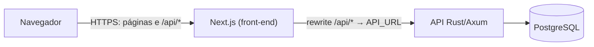

# TabWallet

Aplicação web de controle financeiro pessoal: a própria pessoa registra Receitas, Despesas, Transações fixas e compras no Cartão de crédito, e o sistema calcula o Saldo atual, o Saldo projetado de 12 meses, as Faturas, os Orçamentos e os relatórios. Não há integração bancária. O slogan: "Seu dinheiro, em uma aba."

O projeto é o MVP descrito no [termo de abertura](docs/termo-abertura-tabwallet.md) (Anexo I: casos de uso UC01–UC22, requisitos e arquitetura).

## Onde está cada coisa

| Documento | Para quê |
| --- | --- |
| [`docs/termo-abertura-tabwallet.md`](docs/termo-abertura-tabwallet.md) | Escopo, casos de uso, requisitos não funcionais e arquitetura (seções 2 a 4 do Anexo I) |
| [`GLOSSARY.md`](GLOSSARY.md) | Vocabulário do domínio (Saldo atual, Fatura, Mês de referência...), com o nome usado no código |
| [`docs/adr/`](docs/adr) | Decisões de arquitetura: [0001](docs/adr/0001-shadcn-ui-no-front-end.md) shadcn/ui, [0002](docs/adr/0002-calculo-na-leitura.md) cálculo na leitura, [0003](docs/adr/0003-compras-no-cartao-e-saldo.md) compras no cartão e saldo |
| [`docs/design/`](docs/design/README.md) | Manual de marca e Design System (tokens, componentes) |
| [`docs/nao-funcionais.md`](docs/nao-funcionais.md) | Como cada requisito não funcional foi verificado, com os números medidos |
| [`backend/README.md`](backend/README.md) | API: rotas, regras e como rodar os testes |
| [`frontend/README.md`](frontend/README.md) | Telas, organização e autenticação do front-end |

## Stack

- **Back-end** (`backend/`): Rust, Axum, `sqlx` e PostgreSQL 17. Camadas: handlers HTTP, use cases (`*UseCase`) e repositórios. Dinheiro em centavos inteiros; "hoje" vem de um relógio injetável no fuso America/Sao_Paulo.
- **Front-end** (`frontend/`): Next.js 16 (App Router), React 19, TypeScript, TanStack Query, Recharts e shadcn/ui sobre Tailwind CSS v4 com o tema do Design System.
- **Sessão**: JWT em cookie `httpOnly` (`SameSite=Lax`, `Secure` em produção). O navegador só fala com o Next.js; ele encaminha `/api/*` à API (uma origem só, sem CORS).
- **CI**: GitHub Actions (`.github/workflows/ci.yml`) com os jobs `backend` e `frontend`.



## Como rodar localmente

Pré-requisitos: Node.js 22, Docker e, para rodar a API direto, Rust stable (no Windows, as ferramentas de build C++ do Visual Studio).

### Opção 1: Rust instalado

```bash
# 1. Banco e API
cd backend
docker compose up -d            # PostgreSQL em localhost:5432
cp .env.example .env
cargo run                       # aplica as migrations e sobe em 127.0.0.1:8080

# 2. Front-end (outro terminal)
cd frontend
cp .env.example .env.local      # API_URL=http://127.0.0.1:8080
npm ci
npm run dev                     # http://localhost:3000
```

### Opção 2: sem Rust nativo (só Docker), como no Windows sem as ferramentas C++

```bash
backend/scripts/dev-api.sh 8080     # API + PostgreSQL descartável, na porta 8080 (Ctrl-C para parar)
cd frontend && npm ci && npm run dev
```

Os dados do `dev-api.sh` somem quando ele é encerrado. Em desenvolvimento, o link de recuperação de senha aparece no log da API, porque nenhum e-mail é enviado.

## Variáveis de ambiente

### API (`backend/`, veja `backend/.env.example`)

| Variável | Em produção | Descrição |
| --- | --- | --- |
| `DATABASE_URL` | obrigatória | Conexão com o PostgreSQL. |
| `JWT_SECRET` | obrigatória | Segredo do JWT (HS256), com 32 caracteres ou mais; gere um por ambiente (`openssl rand -base64 48`) e nunca versione. A API não sobe sem ele. |
| `COOKIE_SECURE` | deixe sem definir | O cookie de sessão é `Secure` (só HTTPS), a menos que valha `false`. Só use `false` no desenvolvimento local, em HTTP. |
| `APP_URL` | obrigatória | Endereço público do front-end, exatamente como o navegador o abre (`https://...`, sem barra no fim). Vai no link do e-mail de recuperação e **também é a única origem aceita em requisições que alteram dados** (proteção contra CSRF): se estiver errada, gravações pela interface passam a responder 403. |
| `APP_ENV` | deixe sem definir | `development` relaxa duas exigências (e-mail e `APP_URL`); qualquer outro valor, inclusive o padrão, é produção. |
| `EMAIL_PROVIDER`, `EMAIL_API_KEY`, `EMAIL_FROM`, `EMAIL_API_URL` | obrigatórias | E-mail transacional da recuperação de senha (`resend`, ou uma API no mesmo formato). Em produção a API recusa subir sem provedor. |
| `BIND_ADDR` | opcional | Padrão `0.0.0.0:8080`. |
| `RUST_LOG` | opcional | Nível de log (padrão `info`). |

### Front-end (`frontend/`, veja `frontend/.env.example`)

| Variável | Descrição |
| --- | --- |
| `API_URL` | Endereço interno da API (padrão `http://127.0.0.1:8080`). Lido ao compilar e ao subir; defina em produção. |

Em produção o front-end deve ser servido só por HTTPS (a Vercel já faz isso); ele envia `Strict-Transport-Security` e `upgrade-insecure-requests` quando compilado para produção.

## Testes e verificações

| O quê | Comando | Observação |
| --- | --- | --- |
| Back-end: formato, clippy e testes | `cd backend && cargo fmt --check && cargo clippy --all-targets -- -D warnings && cargo test` | Os testes sobem um PostgreSQL de verdade (Docker). |
| Back-end sem Rust nativo | `backend/scripts/check.sh [filtro]` | Roda o mesmo no Docker, com um PostgreSQL descartável. `backend/scripts/fmt.sh` aplica o `cargo fmt`. |
| Carga (desempenho) | `backend/scripts/load-check.sh` | Veja [`docs/nao-funcionais.md`](docs/nao-funcionais.md). Não roda no CI. |
| Front-end | `cd frontend && npm run typecheck && npm run lint && npm test && npm run build` | |

### Estratégia de testes

- **Back-end**: o ponto de teste é a API HTTP. Cada teste de integração (`backend/tests/*.rs`) chama a API de verdade contra um PostgreSQL real, sem mocks de banco, com o relógio controlado pelo teste para avançar "hoje" (vencimento de Fatura, Ocorrências, Saldo projetado). Cada teste conta uma situação do glossário. Cobrem as regras críticas: saldo, cartão e Faturas, parcelas, pagamentos, Saldo rolado, Antecipação, Transações fixas, Categorias, Orçamentos, relatórios, autenticação e isolamento entre usuários. Os testes unitários ficam junto do código do cálculo (`backend/src/ledger`).
- **Front-end**: Vitest + Testing Library para formatação de dinheiro, linhas de extrato, diálogos e telas, e uma verificação automática de acessibilidade (axe) dos formulários e diálogos.
- **CI**: a cada PR e a cada push na `main`, o GitHub Actions roda `backend` (fmt, clippy, `cargo test`) e `frontend` (typecheck, lint, testes, build). A `main` só recebe merge com os dois verdes.

## Limitações conhecidas

- **Sessão de 7 dias sem revogação**: o JWT vale até expirar; sair da conta apaga o cookie do navegador, mas um token copiado continua válido até vencer. Trocar `JWT_SECRET` encerra todas as sessões.
- **Limite de tentativas em memória**: o limite de login (5 falhas por 15 minutos por e-mail) e de pedidos de recuperação de senha (3 por hora por e-mail) fica na memória de cada instância da API; com várias instâncias, vale por instância, e um reinício zera as contagens.
- **CSP com `'unsafe-inline'`**: a Content-Security-Policy permite scripts e estilos inline, porque nonces exigiriam renderização 100% dinâmica e são incompatíveis com a pré-renderização parcial usada (veja `docs/nao-funcionais.md`).
- **Sem verificação de e-mail** no cadastro, sem exclusão de conta e sem notificações por e-mail ou push (fora do escopo do MVP).
- **Saldo projetado** até 12 meses e só com o que já foi lançado; sem moedas múltiplas, contas ou carteiras.
- **Implantação** (Vercel, Fly.io ou Railway, PostgreSQL gerenciado e o pipeline de deploy) ainda não foi feita; depende de contas do responsável (ticket #6).
- **Safari**: não foi possível testar em Safari neste ambiente; veja `docs/nao-funcionais.md`.
