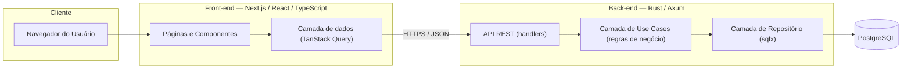
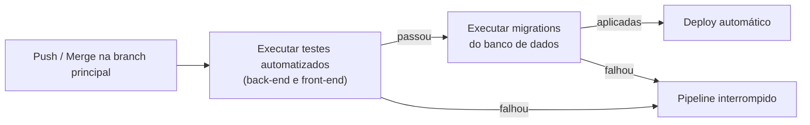

# Termo de Abertura de Projeto

## I – Título do Projeto

**TabWallet** — Sistema Web de Controle Financeiro Pessoal

## II – Justificativa

Grande parte das pessoas físicas não possui uma visão consolidada de suas receitas e despesas, o que dificulta o controle de gastos e o planejamento financeiro do dia a dia. Este projeto propõe uma aplicação web simples e independente, na qual o próprio usuário registra e organiza suas movimentações financeiras, sem depender de integrações bancárias ou assinaturas pagas.

## III – Objetivo do Projeto

Desenvolver e entregar, até **01/12/2026**, uma aplicação web funcional de controle financeiro pessoal, com back-end em **Rust (Axum)** e front-end em **Next.js/React/TypeScript**, permitindo ao usuário cadastrar receitas e despesas, categorizá-las, acompanhar saldo e visualizar relatórios de gastos por período.

O entregável é um **produto de software (MVP funcional)**, acompanhado da documentação técnica e acadêmica exigida pela disciplina, incluindo um **relatório de acompanhamento** intermediário, a ser entregue em **27/10/2026**.

## IV – Benefícios do Projeto

- Disponibilização de uma ferramenta prática e gratuita para controle financeiro pessoal, utilizável pelo próprio autor e por terceiros interessados.
- Produção de material técnico e teórico que pode compor o referencial do TCC/trabalho acadêmico (levantamento de requisitos, arquitetura, decisões de projeto).
- Construção de portfólio técnico demonstrando domínio de uma stack back-end de alta performance (Rust/Axum) integrada a um front-end moderno (Next.js/React/TypeScript).
- Base de código reutilizável para evoluções futuras (ex.: metas financeiras, múltiplos usuários, relatórios avançados).

## V – Exclusões do Projeto

Não fazem parte do escopo deste projeto:

- Integração automática com bancos ou instituições financeiras (Open Banking).
- Aplicativo mobile nativo (iOS/Android) — o acesso mobile se dará via navegador, com layout responsivo.
- Suporte a múltiplas moedas ou internacionalização.
- Funcionalidades de assessoria financeira automatizada, investimentos ou recomendações de crédito.
- Suporte a múltiplos usuários com hierarquia corporativa (o sistema é voltado ao uso individual/pessoal).

## VI – Designação do Gerente

**Gerente do Projeto:** Jorge Miguel Eberhard da Conceição

Responsável pelas decisões técnicas, de escopo e de cronograma do projeto, incluindo:

- Definição e priorização das funcionalidades do MVP.
- Escolhas de arquitetura e stack tecnológica.
- Gestão do orçamento estimado (item VIII), sem necessidade de aprovação externa para os valores fictícios/simbólicos aqui descritos.
- Elaboração e entrega do relatório de acompanhamento em 27/10/2026.
- Validação final do escopo entregue junto ao professor orientador/avaliador da disciplina antes da submissão.

## VII – Partes Interessadas (Stakeholders)

| Parte Interessada                                       | Papel no Projeto                                                                                           |
| ------------------------------------------------------- | ---------------------------------------------------------------------------------------------------------- |
| Jorge Miguel Eberhard da Conceição                      | Gerente do projeto, desenvolvedor (front-end e back-end)                                                   |
| Professor(a) orientador(a) / avaliador(a) da disciplina | Validação acadêmica, avaliação do relatório de acompanhamento e da entrega final, aprovação do trabalho    |
| Usuários finais                                         | Pessoas físicas interessadas em controle financeiro pessoal, potenciais testadores do MVP                  |

## VIII – Orçamento Resumido

O orçamento abaixo é **estimado e fictício**, elaborado para fins de exercício de planejamento de projeto, considerando uma operação de pequeno porte hospedada em serviços de nuvem de baixo custo.

| Item                                                                                | Valor Estimado  |
| ----------------------------------------------------------------------------------- | --------------- |
| Desenvolvimento (dedicação do responsável, valorada como consultoria júnior)        | R$ 8.000,00     |
| Infraestrutura e hospedagem (backend, banco de dados gerenciado, domínio) — 4 meses | R$ 480,00       |
| Ferramentas e serviços (monitoramento, e-mail transacional, certificado SSL)        | R$ 320,00       |
| Reserva de contingência (10%)                                                       | R$ 880,00       |
| **Total estimado**                                                                  | **R$ 9.680,00** |

Trata-se de uma estimativa com margem de variação de **±15%** (entre R$ 8.228,00 e R$ 11.132,00), já que os custos de infraestrutura podem variar conforme o provedor escolhido e não há, neste momento, contratação formal de nenhum serviço.

## IX – Cronograma Básico do Projeto

Prazo total do projeto: **28/09/2026 (segunda-feira) a 01/12/2026** (aproximadamente 9 semanas).

| Fase                                                       | Período       | Duração     |
| ---------------------------------------------------------- | ------------- | ----------- |
| 1. Planejamento e levantamento de requisitos               | 28/09 – 04/10 | 1 semana    |
| 2. Modelagem de dados e arquitetura do sistema             | 05/10 – 11/10 | 1 semana    |
| 3. Desenvolvimento do back-end (API REST em Rust/Axum)     | 12/10 – 01/11 | 3 semanas   |
| 4. Desenvolvimento do front-end (Next.js/React/TypeScript) | 02/11 – 15/11 | 2 semanas   |
| 5. Integração front-end/back-end e testes                  | 16/11 – 22/11 | 1 semana    |
| 6. Documentação final, ajustes e entrega                   | 23/11 – 01/12 | ~1,5 semana |

### Marcos do Projeto

| Marco                                  | Data       | Descrição                                                                                                                     |
| -------------------------------------- | ---------- | ----------------------------------------------------------------------------------------------------------------------------- |
| Início do projeto                      | 28/09/2026 | Aprovação do termo de abertura e início do planejamento.                                                                      |
| Entrega do relatório de acompanhamento | 27/10/2026 | Relatório intermediário com o andamento do projeto: requisitos e arquitetura concluídos, estado do back-end, riscos e ajustes. |
| Entrega final                          | 01/12/2026 | Entrega do MVP funcional em produção e da documentação técnica e acadêmica.                                                   |

## X – Premissas

- O responsável pelo projeto terá disponibilidade regular para desenvolvimento ao longo das cerca de 9 semanas do cronograma.
- Os serviços de hospedagem e banco de dados escolhidos oferecerão suporte compatível com aplicações em Rust (back-end) e Node.js (front-end Next.js).
- O usuário final utilizará navegadores modernos e atualizados (Chrome, Firefox, Edge ou Safari) para acessar a aplicação.
- O professor(a) orientador(a) estará disponível para validações periódicas ao longo do desenvolvimento, incluindo a avaliação do relatório de acompanhamento.
- Não haverá mudanças de escopo relevantes impostas pela instituição após a aprovação deste termo.

## XI – Restrições

O projeto está sujeito a uma restrição de **prazo fixo**, com duas datas definidas pelo calendário acadêmico:

- **27/10/2026** — entrega do relatório de acompanhamento;
- **01/12/2026** — entrega final, que deve ocorrer impreterivelmente até esta data.

Entre prazo e orçamento, **o prazo é a restrição prioritária** — como o orçamento apresentado é estimado/fictício e não envolve desembolso real obrigatório, eventuais variações de custo têm impacto secundário quando comparadas ao risco de não concluir o MVP dentro do semestre letivo.

---

# Anexo I — Especificação Funcional e Arquitetura Técnica

Este anexo complementa o Termo de Abertura com o detalhamento funcional e técnico do sistema, servindo de base para o planejamento de desenvolvimento.

## 1. Atores

- **Usuário**: pessoa física que utiliza o sistema para gerenciar suas finanças pessoais.
- **Sistema**: responsável por processar, armazenar e apresentar as informações financeiras do usuário.

## 2. Casos de Uso Funcionais

| #    | Caso de Uso                            | Descrição                                                                                                                                                                                                         |
| ---- | -------------------------------------- | ----------------------------------------------------------------------------------------------------------------------------------------------------------------------------------------------------------------- |
| UC01 | Cadastrar conta de usuário             | O usuário cria uma conta com e-mail e senha.                                                                                                                                                                      |
| UC02 | Autenticar-se no sistema               | O usuário faz login e logout de forma segura.                                                                                                                                                                     |
| UC03 | Recuperar senha                        | O usuário redefine a senha em caso de esquecimento.                                                                                                                                                               |
| UC04 | Cadastrar transação                    | O usuário registra uma receita ou despesa, com valor, data, descrição e categoria.                                                                                                                                |
| UC05 | Cadastrar gasto fixo                   | O usuário registra um gasto fixo (ex.: aluguel, assinatura), definindo valor e o dia do mês em que ocorre; o sistema replica automaticamente esse gasto em todas as projeções futuras a partir do dia estipulado. |
| UC06 | Editar transação                       | O usuário altera dados de uma transação já cadastrada, incluindo valor, data, descrição e categoria.                                                                                                             |
| UC07 | Excluir transação                      | O usuário remove uma transação cadastrada.                                                                                                                                                                        |
| UC08 | Listar e filtrar transações            | O usuário visualiza suas transações filtrando por período, categoria ou tipo (receita/despesa).                                                                                                                   |
| UC09 | Gerenciar categorias                   | O usuário cria, renomeia ou remove (desativa) categorias de transações (ex.: Alimentação, Transporte, Salário); uma categoria removida é apenas desativada, permanecendo associada às transações existentes e deixando de aparecer como opção para novos lançamentos. |
| UC10 | Visualizar saldo                       | O sistema exibe o saldo atual e o histórico de saldo ao longo do tempo.                                                                                                                                           |
| UC11 | Visualizar relatórios                  | O sistema apresenta gráficos de gastos por categoria e por período.                                                                                                                                               |
| UC12 | Definir orçamento mensal por categoria | O usuário estabelece um limite de gasto mensal para uma categoria.                                                                                                                                                |
| UC13 | Receber alerta de orçamento excedido   | O sistema sinaliza quando o gasto em uma categoria ultrapassa o limite definido.                                                                                                                                  |
| UC14 | Editar perfil                          | O usuário atualiza seus dados de conta (nome, e-mail, senha).                                                                                                                                                     |
| UC15 | Cadastrar gasto em cartão de crédito   | O usuário registra uma despesa vinculada a um cartão de crédito, associando-a à fatura correspondente.                                                                                                           |
| UC16 | Definir data de fechamento de fatura   | O usuário configura o dia do mês em que a fatura do cartão de crédito fecha, usado para determinar em qual fatura cada gasto entra.                                                                              |
| UC17 | Adiantar pagamento de fatura           | O usuário registra o pagamento antecipado (total ou parcial) de uma fatura do cartão de crédito ainda não fechada ou vencida.                                                                                    |
| UC18 | Lançar gasto parcelado no cartão       | O usuário registra uma despesa no cartão de crédito em N parcelas, e o sistema distribui automaticamente o valor entre as faturas seguintes.                                                                     |

## 3. Requisitos Não Funcionais

| Categoria            | Requisito                                                                                                                                           |
| -------------------- | --------------------------------------------------------------------------------------------------------------------------------------------------- |
| **Desempenho**       | 95% das requisições à API devem responder em até 300ms sob carga normal.                                                                            |
| **Segurança**        | Senhas armazenadas com hash (Argon2), autenticação via JWT, comunicação exclusivamente via HTTPS, proteção contra CSRF, XSS e SQL Injection.        |
| **Usabilidade**      | Interface responsiva, funcional em desktop e dispositivos móveis via navegador.                                                                     |
| **Disponibilidade**  | Ambiente hospedado com expectativa de disponibilidade superior a 99% durante o período de avaliação acadêmica.                                      |
| **Manutenibilidade** | Código fortemente tipado (TypeScript no front-end, Rust no back-end), com testes automatizados nas regras de negócio críticas.                      |
| **Portabilidade**    | Aplicação acessível via navegadores modernos (Chrome, Firefox, Edge, Safari), sem dependência de plugins.                                           |
| **Escalabilidade**   | Arquitetura em camadas que permita evolução futura (ex.: suporte a múltiplos usuários simultâneos, novas funcionalidades) sem reescrita estrutural. |

## 4. Arquitetura do Sistema

_Nota: por boas práticas, todo o código do projeto (nomes de variáveis, funções, classes e comentários) deve ser escrito em inglês, independentemente da documentação acadêmica permanecer em português._

### 4.1 Visão Geral

### 4.2 Front-end

- **Stack**: Next.js (App Router), React, TypeScript.
- **Organização**: rotas em `app/`, componentes reutilizáveis para formulários, tabelas e gráficos.
- **Estado e dados remotos**: TanStack Query para cache e sincronização com a API; estado local leve (formulários, UI) via React Context ou Zustand.
- **Autenticação**: token JWT armazenado em cookie `httpOnly`, com verificação de sessão em middleware do Next.js.
- **Visualização de dados**: biblioteca de gráficos (ex.: Recharts) para relatórios de gastos.

### 4.3 Back-end

- **Stack**: Rust com o framework Axum.
- **Organização em camadas**: arquitetura orientada a **use cases**, cada regra de negócio isolada em uma unidade própria e testável.
  - **Handlers/Routes**: recebem a requisição HTTP, validam entrada e acionam o use case correspondente.
  - **Use Cases**: um caso de uso por operação de negócio, com nomes de classe sempre terminados em `UseCase` (ex.: `CreateTransactionUseCase`, `RegisterFixedExpenseUseCase`, `CalculateBalanceUseCase`, `CheckBudgetExceededUseCase`), sem conhecimento do protocolo HTTP.
  - **Repository**: acesso a dados via `sqlx`, isolando os use cases do banco de dados.
- **Autenticação**: middleware de verificação de JWT nas rotas protegidas.
- **Validação**: validação de entrada com a crate `validator`.
- **Migrações**: controladas via `sqlx-cli` (migrations versionadas).

### 4.4 Banco de Dados

- **SGBD**: PostgreSQL.
- **Entidades principais**: `users`, `transactions`, `categories`, `budgets`, `credit_cards`, `invoices`.
  - `credit_cards`: cartões de crédito cadastrados pelo usuário, com dia de fechamento da fatura.
  - `invoices`: faturas geradas por cartão/mês (status: aberta, fechada, paga), agrupando os gastos e pagamentos/adiantamentos correspondentes.
  - Gastos parcelados em `transactions` são distribuídos entre faturas (`invoices`) subsequentes, uma parcela por fatura.

### 4.5 Implantação (Deploy)

- **Front-end**: hospedado na Vercel (nativo para Next.js).
- **Back-end**: containerizado com Docker, hospedado em serviço como Fly.io ou Railway.
- **Banco de dados**: instância gerenciada de PostgreSQL (ex.: Neon ou Supabase).

### 4.6 Fluxo de Branches (Gitflow Simplificado)

- O repositório utiliza um fluxo simplificado, sem branches de desenvolvimento/release/hotfix separadas: **`main` é a branch de produção**, e todo o desenvolvimento ocorre em branches de feature próprias, integradas via **Pull Request direto para `main`**.
- O merge do PR só é permitido se a suíte de testes automatizados (back-end e front-end) for executada com sucesso via **GitHub Actions**, sem ocorrer nenhum erro — a branch `main` é protegida e o merge é bloqueado caso qualquer teste falhe.
- Após o merge em `main`, o pipeline de CI/CD (seção 4.7) é disparado automaticamente, aplicando as migrations e realizando o deploy.

### 4.7 CI/CD

O pipeline de integração e entrega contínua é executado a cada push/merge na branch principal, com as seguintes etapas em sequência — cada uma só é iniciada se a anterior for concluída com sucesso:

1. **Testes**: suíte de testes do back-end (Rust) e do front-end (TypeScript) é executada; qualquer falha interrompe o pipeline e bloqueia o deploy.
2. **Migrations**: somente após os testes passarem, as migrations pendentes do banco de dados são aplicadas.
3. **Deploy**: com testes e migrations concluídos, o deploy automático do back-end e do front-end é disparado.

Se qualquer etapa falhar, o pipeline é interrompido e a versão anterior em produção permanece inalterada.
