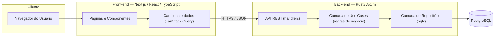
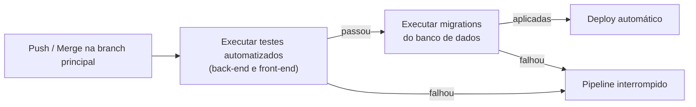

# Termo de Abertura de Projeto

## I – Título do Projeto

**TabWallet** — Sistema Web de Controle Financeiro Pessoal

## II – Justificativa

Grande parte das pessoas físicas não possui uma visão consolidada de suas receitas e despesas, o que dificulta o controle de gastos e o planejamento financeiro do dia a dia. Este projeto propõe uma aplicação web simples e independente, na qual o próprio usuário registra e organiza suas movimentações financeiras, sem depender de integrações bancárias ou assinaturas pagas.

## III – Objetivo do Projeto

Desenvolver e entregar, até **01/12/2026**, uma aplicação web funcional de controle financeiro pessoal, com back-end em **Rust (Axum)** e front-end em **Next.js/React/TypeScript**, permitindo ao usuário cadastrar receitas e despesas, categorizá-las, acompanhar saldo e visualizar relatórios de gastos por período.

O entregável é um **produto de software (MVP funcional)**, acompanhado da documentação técnica e acadêmica exigida pela disciplina, incluindo um **relatório de acompanhamento** intermediário, a ser entregue em **27/10/2026**.

## IV – Benefícios do Projeto

- Disponibilização de uma ferramenta prática e gratuita para controle financeiro pessoal, utilizável pelo próprio autor e por terceiros interessados.
- Produção de material técnico e teórico que pode compor o referencial do TCC/trabalho acadêmico (levantamento de requisitos, arquitetura, decisões de projeto).
- Construção de portfólio técnico demonstrando domínio de uma stack back-end de alta performance (Rust/Axum) integrada a um front-end moderno (Next.js/React/TypeScript).
- Base de código reutilizável para evoluções futuras (ex.: metas financeiras, múltiplos usuários, relatórios avançados).

## V – Exclusões do Projeto

Não fazem parte do escopo deste projeto:

- Integração automática com bancos ou instituições financeiras (Open Banking).
- Aplicativo mobile nativo (iOS/Android) — o acesso mobile se dará via navegador, com layout responsivo.
- Suporte a múltiplas moedas ou internacionalização.
- Funcionalidades de assessoria financeira automatizada, investimentos ou recomendações de crédito.
- Suporte a múltiplos usuários com hierarquia corporativa (o sistema é voltado ao uso individual/pessoal).
- Múltiplas contas ou carteiras: existe um único saldo por usuário.
- Limite de crédito do cartão e cálculo automático de juros, multa ou IOF: o usuário informa os encargos cobrados pelo banco.
- Conceito de estorno: um estorno recebido é lançado como receita.
- Verificação de e-mail no cadastro e exclusão de conta.
- Notificações por e-mail ou push: os alertas de orçamento aparecem apenas dentro do sistema.
- Assinaturas e transações fixas lançadas numa fatura de cartão: transações fixas sempre debitam ou creditam direto no saldo.

**Item desejável (fora do MVP, entra se houver tempo):** transação fixa vinculada a um cartão de crédito, gerando uma compra na fatura todo mês.

## VI – Designação do Gerente

**Gerente do Projeto:** Jorge Miguel Eberhard da Conceição

Responsável pelas decisões técnicas, de escopo e de cronograma do projeto, incluindo:

- Definição e priorização das funcionalidades do MVP.
- Escolhas de arquitetura e stack tecnológica.
- Gestão do orçamento estimado (item VIII), sem necessidade de aprovação externa para os valores fictícios/simbólicos aqui descritos.
- Elaboração e entrega do relatório de acompanhamento em 27/10/2026.
- Validação final do escopo entregue junto ao professor orientador/avaliador da disciplina antes da submissão.

## VII – Partes Interessadas (Stakeholders)

| Parte Interessada                                       | Papel no Projeto                                                                                           |
| ------------------------------------------------------- | ---------------------------------------------------------------------------------------------------------- |
| Jorge Miguel Eberhard da Conceição                      | Gerente do projeto, desenvolvedor (front-end e back-end)                                                   |
| Professor(a) orientador(a) / avaliador(a) da disciplina | Validação acadêmica, avaliação do relatório de acompanhamento e da entrega final, aprovação do trabalho    |
| Usuários finais                                         | Pessoas físicas interessadas em controle financeiro pessoal, potenciais testadores do MVP                  |

## VIII – Orçamento Resumido

O orçamento abaixo é **estimado e fictício**, elaborado para fins de exercício de planejamento de projeto, considerando uma operação de pequeno porte hospedada em serviços de nuvem de baixo custo.

| Item                                                                                | Valor Estimado  |
| ----------------------------------------------------------------------------------- | --------------- |
| Desenvolvimento (dedicação do responsável, valorada como consultoria júnior)        | R$ 8.000,00     |
| Infraestrutura e hospedagem (backend, banco de dados gerenciado, domínio) — 4 meses | R$ 480,00       |
| Ferramentas e serviços (monitoramento, e-mail transacional, certificado SSL)        | R$ 320,00       |
| Reserva de contingência (10%)                                                       | R$ 880,00       |
| **Total estimado**                                                                  | **R$ 9.680,00** |

Trata-se de uma estimativa com margem de variação de **±15%** (entre R$ 8.228,00 e R$ 11.132,00), já que os custos de infraestrutura podem variar conforme o provedor escolhido e não há, neste momento, contratação formal de nenhum serviço.

## IX – Cronograma Básico do Projeto

Prazo total do projeto: **28/09/2026 (segunda-feira) a 01/12/2026** (aproximadamente 9 semanas).

| Fase                                                       | Período       | Duração     |
| ---------------------------------------------------------- | ------------- | ----------- |
| 1. Planejamento e levantamento de requisitos               | 28/09 – 04/10 | 1 semana    |
| 2. Modelagem de dados e arquitetura do sistema             | 05/10 – 11/10 | 1 semana    |
| 3. Desenvolvimento do back-end (API REST em Rust/Axum)     | 12/10 – 01/11 | 3 semanas   |
| 4. Desenvolvimento do front-end (Next.js/React/TypeScript) | 02/11 – 15/11 | 2 semanas   |
| 5. Integração front-end/back-end e testes                  | 16/11 – 22/11 | 1 semana    |
| 6. Documentação final, ajustes e entrega                   | 23/11 – 01/12 | ~1,5 semana |

### Marcos do Projeto

| Marco                                  | Data       | Descrição                                                                                                                     |
| -------------------------------------- | ---------- | ----------------------------------------------------------------------------------------------------------------------------- |
| Início do projeto                      | 28/09/2026 | Aprovação do termo de abertura e início do planejamento.                                                                      |
| Entrega do relatório de acompanhamento | 27/10/2026 | Relatório intermediário com o andamento do projeto: requisitos e arquitetura concluídos, estado do back-end, riscos e ajustes. |
| Entrega final                          | 01/12/2026 | Entrega do MVP funcional em produção e da documentação técnica e acadêmica.                                                   |

## X – Premissas

- O responsável pelo projeto terá disponibilidade regular para desenvolvimento ao longo das cerca de 9 semanas do cronograma.
- Os serviços de hospedagem e banco de dados escolhidos oferecerão suporte compatível com aplicações em Rust (back-end) e Node.js (front-end Next.js).
- O usuário final utilizará navegadores modernos e atualizados (Chrome, Firefox, Edge ou Safari) para acessar a aplicação.
- O professor(a) orientador(a) estará disponível para validações periódicas ao longo do desenvolvimento, incluindo a avaliação do relatório de acompanhamento.
- Não haverá mudanças de escopo relevantes impostas pela instituição após a aprovação deste termo.

## XI – Restrições

O projeto está sujeito a uma restrição de **prazo fixo**, com duas datas definidas pelo calendário acadêmico:

- **27/10/2026** — entrega do relatório de acompanhamento;
- **01/12/2026** — entrega final, que deve ocorrer impreterivelmente até esta data.

Entre prazo e orçamento, **o prazo é a restrição prioritária** — como o orçamento apresentado é estimado/fictício e não envolve desembolso real obrigatório, eventuais variações de custo têm impacto secundário quando comparadas ao risco de não concluir o MVP dentro do semestre letivo.

---

# Anexo I — Especificação Funcional e Arquitetura Técnica

Este anexo complementa o Termo de Abertura com o detalhamento funcional e técnico do sistema, servindo de base para o planejamento de desenvolvimento.

## 1. Atores

- **Usuário**: pessoa física que utiliza o sistema para gerenciar suas finanças pessoais.
- **Sistema**: responsável por processar, armazenar e apresentar as informações financeiras do usuário.

## 2. Casos de Uso Funcionais

Os termos em itálico seguem o glossário do projeto ([GLOSSARY.md](../GLOSSARY.md)).

| #    | Caso de Uso                                | Descrição                                                                                                                                                                                                                                                                                  |
| ---- | ------------------------------------------ | ------------------------------------------------------------------------------------------------------------------------------------------------------------------------------------------------------------------------------------------------------------------------------------------ |
| UC01 | Cadastrar conta de usuário                 | O usuário cria uma conta com e-mail único e senha. Não há verificação de e-mail no cadastro; o e-mail serve apenas para login e recuperação de senha.                                                                                                                                      |
| UC02 | Autenticar-se no sistema                   | O usuário faz login e logout de forma segura.                                                                                                                                                                                                                                              |
| UC03 | Recuperar senha                            | O usuário redefine a senha em caso de esquecimento.                                                                                                                                                                                                                                        |
| UC04 | Cadastrar transação                        | O usuário registra uma *receita* ou *despesa* fora do cartão, com valor maior que zero (em reais), data (apenas o dia), descrição e *categoria* do mesmo tipo. Uma transação com data futura é uma *projeção*, fora do *saldo atual* até a data chegar.                                      |
| UC05 | Cadastrar transação fixa                   | O usuário registra um *gasto fixo* ou uma *receita fixa* (ex.: aluguel, salário), com valor e dia do mês; em meses mais curtos vale o último dia. As *ocorrências* futuras aparecem como projeções. O usuário pode encerrar a transação fixa; alterar o valor vale a partir do mês da alteração. Assinatura no cartão fica fora do MVP (ver item V). |
| UC06 | Editar transação                           | O usuário altera valor, data, descrição e categoria de uma transação. Numa transação fixa, pode editar o valor de uma única ocorrência sem afetar as futuras. Em compras no cartão e compras parceladas valem as regras dos UC15 e UC18.                                                     |
| UC07 | Excluir transação                          | O usuário remove uma transação. Numa transação fixa, pode excluir uma única ocorrência sem afetar as futuras. Compras e parcelas de uma *fatura* paga não podem ser excluídas.                                                                                                               |
| UC08 | Listar e filtrar transações                | O usuário vê suas transações e os *pagamentos de fatura* (marcados como tal, com o cartão), filtrando por período, categoria, tipo (receita/despesa) ou cartão de crédito. Compras no cartão mostram o cartão e a fatura a que pertencem.                                                    |
| UC09 | Gerenciar categorias                       | O usuário cria, renomeia, desativa e reativa categorias. O nome é único por tipo entre ativas e desativadas. Uma categoria desativada permanece nas transações existentes, não aparece para novos lançamentos e mantém o orçamento guardado. Há categorias padrão para todo usuário novo.   |
| UC10 | Visualizar saldo                           | O sistema exibe o *saldo atual*, o histórico do saldo até hoje (por dia ou por mês) e o *saldo projetado* para os próximos 12 meses. O saldo atual pode ficar negativo.                                                                                                                      |
| UC11 | Visualizar relatórios                      | O sistema apresenta: (a) despesas por categoria num período (padrão: mês atual), por *mês de referência*; (b) receitas × despesas por mês; (c) histórico do saldo. Pagamentos de fatura e saldo rolado não são despesas e ficam fora; encargos e projeções do período entram.             |
| UC12 | Definir orçamento mensal por categoria     | O usuário estabelece um limite de gasto para uma categoria de despesa, que vale todo mês até ser alterado.                                                                                                                                                                                  |
| UC13 | Receber alerta de orçamento excedido       | O sistema exibe, dentro da aplicação, um alerta quando a soma das despesas do mês de referência da categoria, incluindo projeções, passa do limite. Não há e-mail nem notificação push.                                                                                                     |
| UC14 | Editar perfil                              | O usuário atualiza seus dados de conta (nome, e-mail, senha); trocar e-mail ou senha exige a senha atual.                                                                                                                                                                                   |
| UC15 | Lançar compra no cartão de crédito         | O usuário registra uma despesa vinculada a um cartão de crédito. Ela entra na *fatura* conforme o dia de fechamento (até o dia, inclusive, na fatura do mês; depois, na do mês seguinte) e não altera o saldo atual. Conta no mês do vencimento da fatura. Mudar a data realoca a compra.     |
| UC16 | Gerenciar cartão de crédito                | O usuário cadastra um cartão com dia de fechamento e dia de vencimento (alterações valem só para faturas abertas) e pode desativá-lo, quando não há fatura com valor restante. Não há limite de crédito.                                                                                    |
| UC17 | Fazer pagamento antecipado de fatura       | O usuário paga, total ou parcialmente, uma fatura aberta ou fechada antes do vencimento. No dia do vencimento o sistema debita sozinho do saldo o valor restante, e a fatura passa a paga.                                                                                                  |
| UC18 | Lançar compra parcelada no cartão          | O usuário informa o valor total (já com juros, se houver) e o número de parcelas. O valor é dividido em centavos exatos, com o centavo que sobra na primeira parcela, e cada parcela vai para uma fatura consecutiva. Pode ser editada enquanto nenhuma parcela estiver em fatura paga; depois só é possível mudar a categoria e cancelar as parcelas restantes. |
| UC19 | Antecipar parcelas                         | O usuário escolhe parcelas futuras do mesmo cartão e as traz para a fatura aberta, com um desconto opcional dividido proporcionalmente entre elas. A operação pede confirmação, avisa que não pode ser desfeita e é irreversível.                                                           |
| UC20 | Editar pagamento de fatura                 | O usuário corrige o pagamento automático para o valor realmente pago. A diferença vira *saldo rolado* na próxima fatura, e a fatura original passa a paga. A edição continua possível até a fatura que recebeu o saldo rolado ficar paga.                                                   |
| UC21 | Lançar encargos                            | O usuário registra os juros, multa e IOF cobrados pelo banco numa fatura, como despesa da categoria "Juros e encargos". O sistema não calcula juros.                                                                                                                                        |
| UC22 | Definir saldo inicial                      | O usuário informa, uma vez, o saldo que já possuía ao começar a usar o sistema.                                                                                                                                                                                                            |

## 3. Requisitos Não Funcionais

| Categoria            | Requisito                                                                                                                                           |
| -------------------- | --------------------------------------------------------------------------------------------------------------------------------------------------- |
| **Desempenho**       | 95% das requisições à API devem responder em até 300ms sob carga normal.                                                                            |
| **Segurança**        | Senhas armazenadas com hash (Argon2), autenticação via JWT, comunicação exclusivamente via HTTPS, proteção contra CSRF, XSS e SQL Injection.        |
| **Usabilidade**      | Interface responsiva, funcional em desktop e dispositivos móveis via navegador.                                                                     |
| **Disponibilidade**  | Ambiente hospedado com expectativa de disponibilidade superior a 99% durante o período de avaliação acadêmica.                                      |
| **Manutenibilidade** | Código fortemente tipado (TypeScript no front-end, Rust no back-end), com testes automatizados nas regras de negócio críticas.                      |
| **Portabilidade**    | Aplicação acessível via navegadores modernos (Chrome, Firefox, Edge, Safari), sem dependência de plugins.                                           |
| **Escalabilidade**   | Arquitetura em camadas que permita evolução futura (ex.: suporte a múltiplos usuários simultâneos, novas funcionalidades) sem reescrita estrutural. |

## 4. Arquitetura do Sistema

_Nota: por boas práticas, todo o código do projeto (nomes de variáveis, funções, classes e comentários) deve ser escrito em inglês, independentemente da documentação acadêmica permanecer em português._

### 4.1 Visão Geral

### 4.2 Front-end

- **Stack**: Next.js (App Router), React, TypeScript.
- **Organização**: rotas em `app/`, componentes reutilizáveis para formulários, tabelas e gráficos.
- **Estado e dados remotos**: TanStack Query para cache e sincronização com a API; estado local leve (formulários, UI) via React Context ou Zustand.
- **Autenticação**: token JWT armazenado em cookie `httpOnly`, com verificação de sessão em middleware do Next.js.
- **Visualização de dados**: biblioteca de gráficos (ex.: Recharts) para relatórios de gastos.

### 4.3 Back-end

- **Stack**: Rust com o framework Axum.
- **Organização em camadas**: arquitetura orientada a **use cases**, cada regra de negócio isolada em uma unidade própria e testável.
  - **Handlers/Routes**: recebem a requisição HTTP, validam entrada e acionam o use case correspondente.
  - **Use Cases**: um caso de uso por operação de negócio, com nomes de classe sempre terminados em `UseCase` (ex.: `CreateTransactionUseCase`, `RegisterRecurringTransactionUseCase`, `CalculateBalanceUseCase`, `CheckBudgetExceededUseCase`), sem conhecimento do protocolo HTTP.
  - **Repository**: acesso a dados via `sqlx`, isolando os use cases do banco de dados.
- **Autenticação**: middleware de verificação de JWT nas rotas protegidas.
- **Validação**: validação de entrada com a crate `validator`.
- **Migrações**: controladas via `sqlx-cli` (migrations versionadas).

### 4.4 Banco de Dados

- **SGBD**: PostgreSQL.
- **Entidades principais**: `users`, `transactions`, `categories`, `budgets`, `recurring_transactions`, `credit_cards`, `invoices`, `installment_purchases`, `invoice_payments`.
  - `recurring_transactions`: gastos e receitas fixos, com as exceções por mês (ocorrência excluída ou com valor editado). As ocorrências são calculadas na leitura ([ADR-0002](adr/0002-calculo-na-leitura.md)).
  - `credit_cards`: cartões do usuário, com dia de fechamento, dia de vencimento e indicação de ativo.
  - `invoices`: faturas por cartão/mês; o estado (aberta, fechada, paga) deriva das datas e dos pagamentos.
  - `installment_purchases`: compras parceladas, com suas parcelas distribuídas entre faturas consecutivas.
  - `invoice_payments`: pagamentos antecipados e correções do pagamento automático; o pagamento automático do vencimento e o saldo rolado são calculados na leitura.
  - Valores monetários ficam em **centavos inteiros** (reais, moeda única). As regras do modelo estão em [ADR-0003](adr/0003-compras-no-cartao-e-saldo.md).

### 4.5 Implantação (Deploy)

- **Front-end**: hospedado na Vercel (nativo para Next.js).
- **Back-end**: containerizado com Docker, hospedado em serviço como Fly.io ou Railway.
- **Banco de dados**: instância gerenciada de PostgreSQL (ex.: Neon ou Supabase).

### 4.6 Fluxo de Branches (Gitflow Simplificado)

- O repositório utiliza um fluxo simplificado, sem branches de desenvolvimento/release/hotfix separadas: **`main` é a branch de produção**, e todo o desenvolvimento ocorre em branches de feature próprias, integradas via **Pull Request direto para `main`**.
- O merge do PR só é permitido se a suíte de testes automatizados (back-end e front-end) for executada com sucesso via **GitHub Actions**, sem ocorrer nenhum erro — a branch `main` é protegida e o merge é bloqueado caso qualquer teste falhe.
- Após o merge em `main`, o pipeline de CI/CD (seção 4.7) é disparado automaticamente, aplicando as migrations e realizando o deploy.

### 4.7 CI/CD

O pipeline de integração e entrega contínua é executado a cada push/merge na branch principal, com as seguintes etapas em sequência — cada uma só é iniciada se a anterior for concluída com sucesso:

1. **Testes**: suíte de testes do back-end (Rust) e do front-end (TypeScript) é executada; qualquer falha interrompe o pipeline e bloqueia o deploy.
2. **Migrations**: somente após os testes passarem, as migrations pendentes do banco de dados são aplicadas.
3. **Deploy**: com testes e migrations concluídos, o deploy automático do back-end e do front-end é disparado.

Se qualquer etapa falhar, o pipeline é interrompido e a versão anterior em produção permanece inalterada.
